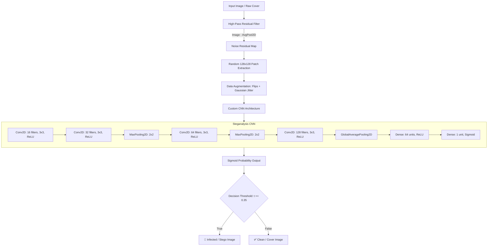

# 🛡️ SteganoImage: Deep Learning-Based Image Steganalysis

[](https://www.python.org/)
[](https://www.tensorflow.org/)
[](https://opencv.org/)
[](https://scikit-learn.org/)
[](LICENSE)
[](https://github.com/Abdullah-Niaz/SteganoImage/pulls)

**SteganoImage** is an end-to-end computer vision and deep learning framework engineered for **Image Steganalysis**—detecting covert payloads and hidden communication concealed within digital images.

By transforming spatial images into **high-pass residual representations**, the model isolates micro-level pixel noise and high-frequency steganographic artifacts from macro-level semantic image contents, achieving high sensitivity detection across diverse image classes.

---

## 📑 Table of Contents

- [Overview](#-overview)
- [Key Features](#-key-features)
- [Architecture & Detection Pipeline](#-architecture--detection-pipeline)
- [Project Directory Structure](#-project-directory-structure)
- [Installation & Setup](#-installation--setup)
- [Dataset Preparation & Infection Suite](#-dataset-preparation--infection-suite)
  - [Dataset Directory Format](#dataset-directory-format)
  - [Batch Infection via Steghide](#1-batch-infection-via-steghide)
  - [LSB High-Capacity Injection](#2-lsb-high-capacity-injection)
- [Training the Model](#-training-the-model)
- [Evaluation & Metrics](#-evaluation--metrics)
- [Mathematical & Theoretical Formulation](#-mathematical--theoretical-formulation)
  - [High-Pass Residual Extraction](#1-high-pass-residual-extraction)
  - [Binary Focal Loss](#2-binary-focal-loss)
- [Exploratory Analysis (Notebook)](#-exploratory-analysis-notebook)
- [Roadmap](#-roadmap)
- [Contributing](#-contributing)
- [License](#-license)

---

## 🔍 Overview

Steganography conceals malicious data, communication channels, or exfiltrated intellectual property within standard media files (such as JPEGs and BMPs) without altering the perceptible appearance to the human eye. Standard image classifiers fail in steganalysis because they focus on high-level semantic features (e.g., shapes, objects, textures) rather than subtle sensor noise anomalies.

**SteganoImage** addresses this challenge through:
1. **Semantic Content Suppression**: A localized high-pass residual filter removes semantic structures, leaving behind sensor noise and stego-perturbations.
2. **Convolutional Residual Pattern Recognition**: A custom CNN architecture trained specifically on $128 \times 128$ residual patches.
3. **Focal Loss Regularization**: Mitigates class imbalance and prioritizes hard-to-detect edge cases with minimal embedding rates.

---

## ✨ Key Features

- **High-Pass Residual Preprocessing**: Fast $5 \times 5$ average pool subtraction that strips semantic image content and surfaces steganographic noise.
- **Optimized Convolutional Architecture**: 5-block convolutional feature extractor tailored for high-frequency residual signal analysis.
- **Focal Loss Integration**: Binary focal loss ($\alpha=0.25$, $\gamma=2.0$) dynamically dampens the loss from well-classified easy samples and amplifies gradients on subtle steganographic modifications.
- **Synthetic Infection Engine**:
  - Automated batch infection using **Steghide** CLI with password protection and payload embedding.
  - Pure Python Least Significant Bit (**LSB**) embedding capable of testing up to 95% channel saturation.
- **Rigorous Evaluation Suite**: Outputs ROC-AUC scores, full Scikit-Learn classification reports (Precision, Recall, F1), and confusion matrices with custom sensitivity thresholding ($t = 0.35$).
- **High-Performance Data Pipeline**: Implemented with `tf.data.Dataset` featuring parallel execution (`AUTOTUNE`), stochastic patching, and steganographic data augmentation.

---

## 🏗️ Architecture & Detection Pipeline



---

## 📁 Project Directory Structure

```plaintext
SteganoImage/
├── dataset/
│   ├── clean/                # Unaltered cover images organized by category
│   │   ├── airplane/
│   │   ├── car/
│   │   ├── cat/
│   │   ├── dog/
│   │   ├── flower/
│   │   ├── fruit/
│   │   ├── motorbike/
│   │   └── person/
│   └── infected/             # Generated stego images containing hidden payloads
├── payload/
│   ├── clean_image.jpg       # Reference sample image
│   ├── code.py               # LSB steganography generator (~95% capacity)
│   ├── infect.py             # Automated Steghide batch infection script
│   ├── infected_image.png    # Sample infected output image
│   ├── infected_max.jpg      # Sample high-capacity infected image
│   └── payload.txt           # Secret payload text for embedding
├── code.ipynb                # Exploratory notebook (MobileNetV2 feature baselines)
├── dataset.py                # tf.data pipeline, residual filter, patch extraction
├── evaluate.py               # Model evaluation (ROC-AUC, Confusion Matrix, Classification Report)
├── loss_function.py          # Custom Binary Focal Loss implementation
├── model.py                  # Custom Steganalysis CNN architecture
├── requirement.txt           # Python package dependencies
├── train.py                  # Model training pipeline with EarlyStopping
└── README.md                 # Project documentation
```

---

## 🚀 Installation & Setup

### 1. Clone the Repository

```bash
git clone https://github.com/Abdullah-Niaz/SteganoImage.git
cd SteganoImage
```

### 2. Create and Activate a Virtual Environment

```bash
# On Windows
python -m venv env
.\env\Scripts\activate

# On Linux / macOS
python3 -m venv env
source env/bin/activate
```

### 3. Install Dependencies

```bash
pip install -r requirement.txt
```

> **Note**: For running the payload simulation scripts (`payload/code.py` and `payload/infect.py`), also install:
> ```bash
> pip install stegano Pillow
> ```

### 4. (Optional) Install Steghide for Batch Infection

If you plan to generate infected images using `payload/infect.py`:
- **Windows**: Download Steghide binaries and place `steghide.exe` in `C:/steghide/steghide.exe` (or adjust `STEHIDE_PATH` in `payload/infect.py`).
- **Ubuntu/Debian**:
  ```bash
  sudo apt-get update && sudo apt-get install steghide -y
  ```

---

## 📦 Dataset Preparation & Infection Suite

### Dataset Directory Format

The dataset directory must follow this folder hierarchy:

```plaintext
dataset/
├── clean/
│   ├── category_1/
│   │   ├── sample_01.jpg
│   │   └── ...
│   └── category_2/
└── infected/
    ├── category_1/
    │   ├── sample_01.jpg
    │   └── ...
    └── category_2/
```

### 1. Batch Infection via Steghide

To automatically inject `payload/payload.txt` across all clean images while mirroring folder structure:

```bash
python payload/infect.py
```

*Configurable parameters in `payload/infect.py`:*
- `STEHIDE_PATH`: Path to your Steghide executable.
- `PASSWORD`: Steghide passphrase (default: `cyber123`).
- `PAYLOAD`: File containing secret data to conceal.
- `SUPPORTED_EXTENSIONS`: File formats targeted (`.jpg`, `.jpeg`, `.bmp`).

### 2. LSB High-Capacity Injection

To test Least Significant Bit (LSB) embedding at near maximum bit capacity (~95% saturation):

```bash
python payload/code.py
```

---

## 🏋️ Training the Model

To train the CNN model using high-pass residual inputs and Focal Loss:

```bash
python train.py
```

### Training Configuration

| Parameter | Setting | Description |
| :--- | :--- | :--- |
| **Input Dimensions** | `(128, 128, 1)` | Grayscale high-pass residual patch |
| **Optimizer** | `Adam(learning_rate=1e-4)` | Adaptive moment estimation |
| **Loss Function** | `focal_loss(gamma=2.0, alpha=0.25)` | Binary Focal Loss |
| **Batch Size** | `32` | Configurable in `dataset.py` |
| **Max Epochs** | `30` | Controlled by Early Stopping |
| **Early Stopping** | `patience=5, restore_best_weights=True` | Prevents overfitting on noise artifacts |
| **Output Model** | `stego_model.h5` | Serialized Keras model weights |

---

## 📊 Evaluation & Metrics

Evaluate the trained model on test data:

```bash
python evaluate.py
```

### Output Metrics
The script evaluates the test partition and displays:
1. **ROC-AUC Score**: Area Under the Receiver Operating Characteristic Curve.
2. **Confusion Matrix**: Quantitative true positive, false positive, true negative, and false negative counts.
3. **Classification Report**: Precision, Recall, and F1-score for both `Clean` and `Infected` classes.

### Threshold Sensitivity Tuning
In security-sensitive environments, minimizing false negatives (undetected stego images) is paramount. `evaluate.py` utilizes a tuned decision threshold:
```python
threshold = 0.35  # Biased toward higher recall for covert payload detection
y_bin = (y_pred > threshold).astype(int)
```

---

## 🔬 Mathematical & Theoretical Formulation

### 1. High-Pass Residual Extraction

Standard images are dominated by low-frequency spatial gradients (scene content). Steganography introduces high-frequency pixel alterations. 

To isolate this residual $R(x, y)$, an average pooling filter ($K \times K$, where $K=5$) is applied:

$$B(x, y) = \frac{1}{K^2} \sum_{i=-\lfloor K/2 \rfloor}^{\lfloor K/2 \rfloor} \sum_{j=-\lfloor K/2 \rfloor}^{\lfloor K/2 \rfloor} I(x+i, y+j)$$

The high-pass residual image $R(x, y)$ is computed by subtracting the blurred image from the original:

$$R(x, y) = I(x, y) - B(x, y)$$

This suppresses image semantics and magnifies embedding artifacts for the CNN feature extractor.

### 2. Binary Focal Loss

In steganographic datasets, subtle embeddings are easily misclassified when models become overconfident on obvious samples. **Focal Loss** downweights easily classifiable examples:

$$\text{FL}(p_t) = -\alpha_t (1 - p_t)^\gamma \log(p_t)$$

Where:
- $p_t$ is the model's estimated probability for the ground truth class.
- $\alpha = 0.25$ balances positive and negative class contributions.
- $\gamma = 2.0$ acts as the focusing parameter, exponentially dampening easy loss contributions while highlighting hard, ambiguous stego residuals.

---

## 📓 Exploratory Analysis (Notebook)

The included Jupyter Notebook [`code.ipynb`](code.ipynb) explores baseline feature extraction using transfer learning:
- Extracts pre-trained spatial representations via **MobileNetV2** (`imagenet` weights, global average pooling).
- Computes **Cosine Similarity** between test candidates and baseline references to evaluate linear separability in deep embedding space.
- Provides a reference baseline comparing off-the-shelf deep features against dedicated residual-domain CNN models.

---

## 🗺️ Roadmap

- [ ] **Frequency Domain Analysis**: Add Discrete Cosine Transform (DCT) and Discrete Wavelet Transform (DWT) residual branches.
- [ ] **Adaptive Steganalysis Support**: Benchmark against modern adaptive steganography algorithms (S-UNIWARD, WOW, HUGO).
- [ ] **REST API & Inference Web UI**: FastAPI backend with a modern drag-and-drop web interface for instant image inspection.
- [ ] **Model Export**: Export optimized ONNX and TensorRT runtime weights for edge deployment.

---

## 🤝 Contributing

Contributions are welcomed! Follow these steps:

1. **Fork the Repository**
2. **Create a Feature Branch**:
   ```bash
   git checkout -b feature/AmazingStegoFeature
   ```
3. **Commit Your Changes**:
   ```bash
   git commit -m "Add AmazingStegoFeature"
   ```
4. **Push to the Branch**:
   ```bash
   git push origin feature/AmazingStegoFeature
   ```
5. **Open a Pull Request**

---

## 📄 License

This project is licensed under the **MIT License**. Feel free to use, modify, and distribute this software for educational and research purposes.

---

<p align="center">
  Developed by <a href="https://github.com/Abdullah-Niaz">Abdullah Niaz</a> • Contributions and feedback are welcome!
</p>
